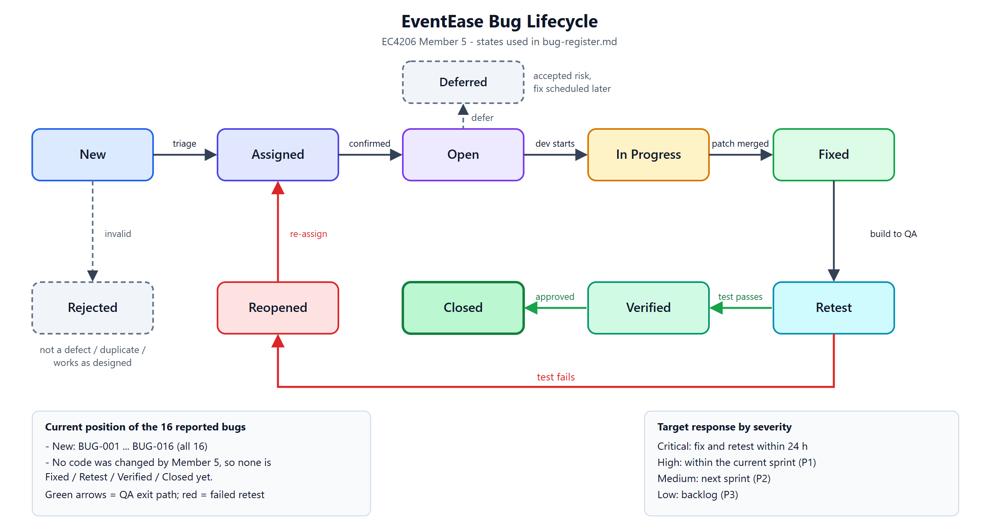

# Bug Lifecycle — EventEase

**Member 5 – Security & Quality Assurance (EC4206 Section 3.8)**

*Diagram source: `diagrams/bug-lifecycle.svg` (hand-drawn SVG, rendered to PNG). This is a process diagram, not a screenshot.*

## 1. Process actually used in this project

Bugs are recorded in `bug-register.md` (one row and one detail block per bug, with severity, priority, status, related test and evidence). Fixes are meant to be made on a Git branch and merged by pull request, then re-tested by QA. No bug tracker such as Jira was used, and no fix has been applied yet, so every bug is currently in the first state.

## 2. States and transitions

| State | Meaning | Who moves it | Exit criterion |
|---|---|---|---|
| **New** | Reported by a tester with steps, expected/actual result and evidence | Tester (Member 5) | Reproduced by a second person or a re-run test |
| **Assigned** | Triaged, severity/priority set, owner chosen | QA lead / team | Owner accepts |
| **Open** | Confirmed valid and accepted into the fix queue | Owner | Work starts |
| **In Progress** | Developer is changing code on a branch | Developer | Patch ready for review |
| **Fixed** | Patch merged to the integration branch | Developer | Build available for QA |
| **Retest** | QA repeats the original test plus a regression check | Tester | Result recorded |
| **Verified** | Retest passed; bug no longer reproducible | Tester | Reviewer agrees |
| **Closed** | Final state; evidence of the retest is attached | QA lead | — |
| **Reopened** | Retest failed or the bug returned; goes back to Assigned | Tester | New analysis |
| **Rejected** | Not a defect, duplicate, or works as designed (reason recorded) | QA lead | — |
| **Deferred** | Valid but accepted as a known risk and scheduled later | Product owner / team | Re-triage at next planning |

## 3. Rules

1. A bug cannot be Closed without a recorded retest and, for security bugs, the same test that found it must now pass.
2. Every Fixed bug triggers a regression run of the related test group (e.g. all A07 tests after a login change).
3. Severity sets the response target: Critical within 24 h; High within the current sprint; Medium next sprint; Low backlog.
4. A Rejected or Deferred decision needs a written reason in the register.

## 4. Current status of the 16 registered bugs

| State | Count | Bugs |
|---|---|---|
| New | 16 | BUG-001 … BUG-016 |
| Assigned / Open / In Progress / Fixed / Retest / Verified / Closed / Reopened / Rejected / Deferred | 0 | — |

**Suggested first moves (for the team to decide):** assign BUG-001, BUG-002 and BUG-010 (P1) first, because each has a small, well-defined fix.

## 5. Example walk-through (BUG-001, login rate limiting)

New → *triage: High / P1, owner assigned* → Assigned → *confirmed, queued* → Open → *rate-limit middleware added on a branch* → In Progress → *PR merged* → Fixed → *run test A07-01: expect HTTP 429 before attempt 20* → Retest → pass → Verified → Closed; if attempt 20 still returned 401 → Reopened and back to Assigned.

*(This walk-through is a worked example of the process, not a record of events that have happened.)*
