# OWASP Security Test Results — EventEase

**Member 5 – Security & Quality Assurance (EC4206 Section 3.7)**
**Target:** local EventEase application only (API `http://localhost:5000`, frontend `http://localhost:5180`), branch `member5-security-qa`
**Test window:** 2026-11-23 → 2026-11-24 · **Standard used:** OWASP Top 10 (2021 categories)

## 1. How the tests were performed

| Layer | Tool | Notes |
|---|---|---|
| API tests | Node.js 24 script (`fetch`) and `curl.exe` in PowerShell | Raw output kept in `raw/api-security-run.json` (cookies/tokens redacted) |
| Browser tests | Google Chrome driven by Playwright | Raw output in `raw/ui-security-run.json`, `raw/browser-storage-run.json` |
| Dependency scan | `npm audit` | Read-only; no package was changed |
| Test accounts | Seed accounts (`*@demo.com`) + one self-registered QA account (`qa.m5.*`) | A second QA account `qa.common.*` and an earlier duplicate set were created by two harness runs; they are harmless test records |

**Screenshot provenance.** Every image in `screenshots/` is either (a) a capture of the real EventEase UI in Chrome, (b) a capture of a real PowerShell window running real `curl.exe`/`node` commands, or (c) a capture of the real SonarQube web UI. Nothing was drawn or edited. An earlier set of HTML "evidence panels" rendered from the JSON was **not** screenshots, so it was moved to `generated-panels-not-screenshots/` and is not used anywhere in this report. Screenshots that scrolled off or were blank are kept untouched in `superseded/`.

## 2. Summary

| Status | Count |
|---|---|
| PASS | 37 |
| FAIL | 14 |
| OBSERVATION | 1 |
| NOT TESTED | 1 |
| **Total** | **53** |

| OWASP category | PASS | FAIL | OBSERVATION | NOT TESTED |
|---|---|---|---|---|
| A01 Broken Access Control | 17 | 0 | 1 | 1 |
| A02 Cryptographic Failures / Sensitive Data | 5 | 0 | 0 | 0 |
| A03 Injection | 7 | 5 | 0 | 0 |
| A05 Security Misconfiguration | 5 | 3 | 0 | 0 |
| A06 Vulnerable & Outdated Components | 0 | 2 | 0 | 0 |
| A07 Identification & Authentication Failures | 3 | 4 | 0 | 0 |

Categories not covered: **A04 Insecure Design** (only partly, through A07-01), **A08 Software/Data Integrity**, **A09 Logging & Monitoring**, **A10 SSRF** (the API makes no user-directed outbound requests except the Gemini AI call). Optional OWASP ZAP scan was **not run** (the ~1 GB image was not installed and was optional).

**Key take-aways**
- Access control is solid: every role and ownership check tested (A01-01 to A01-19; three roles plus anonymous) behaved correctly, including cross-organizer attacks.
- The weakest areas are **authentication hardening** (no rate limiting, logout does not revoke tokens, no breached-password check) and **error handling** (unhandled TypeErrors return HTTP 500 with internal messages).
- Stored XSS is not possible through the tested inputs because React escapes output and zod/handlers validate types.

## 3. Results table

| ID | OWASP | Test | Status | Evidence |
|---|---|---|---|---|
| A01-01 | A01 | Attendee must not reach the admin dashboard | **PASS** | `owasp-03-admin-access-control.png`, `owasp-13-role-restrictions-terminal.png` |
| A01-02 | A01 | Attendee must not reach the organizer dashboard | **PASS** | `owasp-04-organizer-access-control.png`, `owasp-13-role-restrictions-terminal.png` |
| A01-03 | A01 | Unauthenticated request to admin dashboard is rejected | **PASS** | `owasp-05-unauthenticated-access.png`, `owasp-13-role-restrictions-terminal.png` |
| A01-04 | A01 | IDOR: attendee A must not read attendee B booking; body must leak nothing | **PASS** | `owasp-06-attendee-b-bookings.png`, `owasp-07-idor-booking-access.png`, `owasp-12-idor-booking-response-body.png` |
| A01-05 | A01 | Attendee cannot create events (role restriction) | **PASS** | `owasp-13-role-restrictions-terminal.png` |
| A01-06 | A01 | Attendee cannot call admin user-status endpoint | **PASS** | `raw/*.json` only |
| A01-07 | A01 | Attendee cannot use ticket check-in (organizer/admin only) | **PASS** | `raw/*.json` only |
| A01-08 | A01 | Organizer cannot list all users (admin only) | **PASS** | `owasp-13-role-restrictions-terminal.png` |
| A01-09 | A01 | Positive control: organizer CAN reach organizer dashboard (proves 403s above are real role checks) | **PASS** | `raw/*.json` only |
| A01-10 | A01 | Organizer 2 cannot edit Organizer 1's event | **PASS** | `owasp-13-role-restrictions-terminal.png` |
| A01-11 | A01 | Organizer 2 cannot read Organizer 1's attendee list | **PASS** | `owasp-13-role-restrictions-terminal.png` |
| A01-12 | A01 | Organizer 2 cannot publish Organizer 1's event | **PASS** | `raw/*.json` only |
| A01-13 | A01 | Organizer 2 cannot delete Organizer 1's event | **PASS** | `owasp-13-role-restrictions-terminal.png` |
| A01-14 | A01 | Attendee cannot cancel another attendee's booking | **NOT TESTED** | `raw/*.json` only |
| A01-15 | A01 | Mass assignment: role cannot be changed through PATCH /api/auth/me | **PASS** | `owasp-14-token-forgery-mass-assignment-terminal.png` |
| A01-16 | A01 | Mass assignment: register cannot create an admin | **PASS** | `owasp-14-token-forgery-mass-assignment-terminal.png` |
| A01-17 | A01 | Self-registration with organizer role (design observation) | **OBSERVATION** | `raw/*.json` only |
| A01-18 | A01 | Forged / unsigned / malformed session tokens are rejected | **PASS** | `owasp-14-token-forgery-mass-assignment-terminal.png` |
| A01-19 | A01 | Suspended account cannot log in | **PASS** | `raw/*.json` only |
| A02-01 | A02 | Session cookie flags | **PASS** | `owasp-25-session-cookie-flags-terminal.png` |
| A02-02 | A02 | API responses do not expose password hashes, reset tokens or secrets | **PASS** | `raw/*.json` only |
| A02-03 | A02 | JWT content and lifetime | **PASS** | `raw/*.json` only |
| A02-04 | A02 | Admin credentials must not be embedded in the browser bundle | **PASS** | `raw/*.json` only |
| A02-05 | A02 | Session token not exposed to JavaScript or web storage | **PASS** | `raw/*.json` only |
| A03-01 | A03 | NoSQL operator injection in login | **PASS** | `owasp-08-nosql-injection.png`, `owasp-14-token-forgery-mass-assignment-terminal.png` |
| A03-02 | A03 | NoSQL operator object in forgot-password email | **FAIL** | `owasp-15-error-handling-500-terminal.png` |
| A03-03 | A03 | NoSQL operator object in reset-password token | **FAIL** | `owasp-15-error-handling-500-terminal.png` |
| A03-04 | A03 | Type confusion in contact form (object instead of string name) | **FAIL** | `owasp-15-error-handling-500-terminal.png` |
| A03-05 | A03 | NoSQL operators in register are rejected (zod schema) | **PASS** | `raw/*.json` only |
| A03-06 | A03 | Query-string operator injection on event search | **PASS** | `raw/*.json` only |
| A03-07 | A03 | javascript: URL in event banner is rejected | **PASS** | `raw/*.json` only |
| A03-08 | A03 | Server-side validation of profileImage URL | **FAIL** | `owasp-23-profileimage-no-server-validation-terminal.png` |
| A03-09 | A03 | Review comments (stored XSS surface) reachable for testing | **FAIL** | `owasp-22-review-endpoints-unreachable-terminal.png` |
| A03-10 | A03 | Stored XSS in event title (event details page) | **PASS** | `owasp-09-xss-event-title.png`, `owasp-09a-xss-event-title-manage-events.png` |
| A03-11 | A03 | XSS payload through the contact form | **PASS** | `owasp-10a-xss-contact-form-payload-entered.png`, `owasp-10-xss-contact-form.png` |
| A03-12 | A03 | XSS payload in profile name (QA account) | **PASS** | `owasp-11-xss-profile-name.png` |
| A05-01 | A05 | Security headers on the API (Helmet) | **PASS** | `owasp-16-security-headers-api-terminal.png` |
| A05-02 | A05 | Security headers on the frontend web server | **FAIL** | `owasp-16b-security-headers-frontend-terminal.png` |
| A05-03 | A05 | CORS must not trust arbitrary origins when credentials are enabled | **FAIL** | `owasp-17-cors-untrusted-origin-terminal.png` |
| A05-04 | A05 | Malformed JSON does not leak stack traces | **PASS** | `owasp-15-error-handling-500-terminal.png` |
| A05-05 | A05 | Unhandled 500 errors do not reveal internals | **FAIL** | `owasp-15-error-handling-500-terminal.png` |
| A05-06 | A05 | Request body size limit enforced | **PASS** | `raw/*.json` only |
| A05-07 | A05 | Sensitive files not served by the API | **PASS** | `raw/*.json` only |
| A05-08 | A05 | .env files are excluded from Git | **PASS** | `owasp-21-env-gitignore-terminal.png` |
| A06-01 | A06 | Backend dependencies free of known vulnerabilities | **FAIL** | `owasp-01-backend-npm-audit.png` |
| A06-02 | A06 | Frontend dependencies free of known vulnerabilities | **FAIL** | `owasp-02-frontend-npm-audit.png` |
| A07-01 | A07 | Brute-force protection / rate limiting on login | **FAIL** | `owasp-18-login-rate-limit-terminal.png` |
| A07-02 | A07 | Weak password rules on registration | **PASS** | `owasp-19-password-policy-enumeration-terminal.png` |
| A07-03 | A07 | Common/breached passwords are rejected | **FAIL** | `raw/*.json` only |
| A07-04 | A07 | User enumeration | **FAIL** | `owasp-19-password-policy-enumeration-terminal.png` |
| A07-05 | A07 | Session token is invalidated by logout | **FAIL** | `owasp-20-session-after-logout-terminal.png` |
| A07-06 | A07 | Forgot-password does not reveal whether the email exists | **PASS** | `raw/*.json` only |
| A07-07 | A07 | Reset-token lifecycle: weak password rejected, invalid token rejected, one-time use, old password revoked | **PASS** | `raw/*.json` only |

## 4. Detailed results

### A01-01 — Attendee must not reach the admin dashboard
- **OWASP:** A01  ·  **Status:** **PASS**
- **Steps:** Login as attendee; GET /api/admin/dashboard
- **Expected:** HTTP 403
- **Actual:** HTTP 403 {"message":"You do not have permission to access this resource."}
- **Notes / reason:** re-verified in this run (first run: owasp-03)
- **Screenshot(s):** `owasp-03-admin-access-control.png`, `owasp-13-role-restrictions-terminal.png`

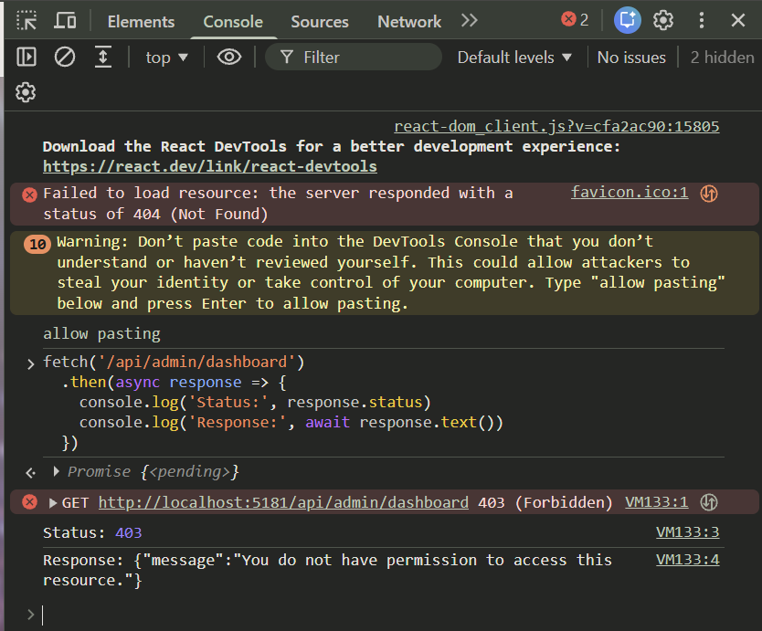 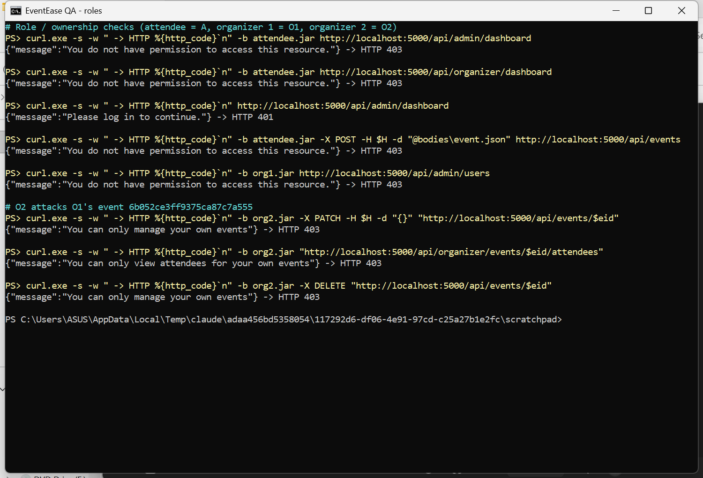

### A01-02 — Attendee must not reach the organizer dashboard
- **OWASP:** A01  ·  **Status:** **PASS**
- **Steps:** Login as attendee; GET /api/organizer/dashboard
- **Expected:** HTTP 403
- **Actual:** HTTP 403 {"message":"You do not have permission to access this resource."}
- **Notes / reason:** re-verified in this run (first run: owasp-04)
- **Screenshot(s):** `owasp-04-organizer-access-control.png`, `owasp-13-role-restrictions-terminal.png`

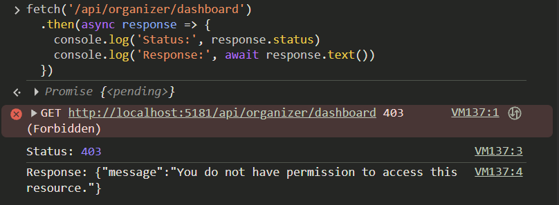 

### A01-03 — Unauthenticated request to admin dashboard is rejected
- **OWASP:** A01  ·  **Status:** **PASS**
- **Steps:** No cookie; GET /api/admin/dashboard
- **Expected:** HTTP 401
- **Actual:** HTTP 401 {"message":"Please log in to continue."}
- **Notes / reason:** re-verified (first run: owasp-05)
- **Screenshot(s):** `owasp-05-unauthenticated-access.png`, `owasp-13-role-restrictions-terminal.png`

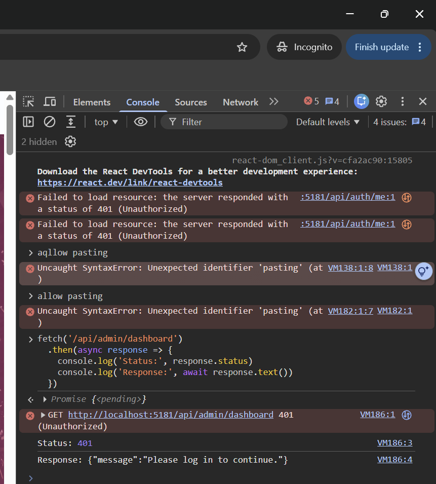 

### A01-04 — IDOR: attendee A must not read attendee B booking; body must leak nothing
- **OWASP:** A01  ·  **Status:** **PASS**
- **Steps:** Kasun's booking ID read by attendee@demo.com; compare with owner (control)
- **Expected:** HTTP 404 and body only a generic message
- **Actual:** Attacker HTTP 404 body={"message":"Booking not found"}; owner control HTTP 200; leaked markers: none
- **Notes / reason:** Body verified: no private fields returned. 404 (not 403) also avoids confirming that the ID exists.
- **Screenshot(s):** `owasp-06-attendee-b-bookings.png`, `owasp-07-idor-booking-access.png`, `owasp-12-idor-booking-response-body.png`

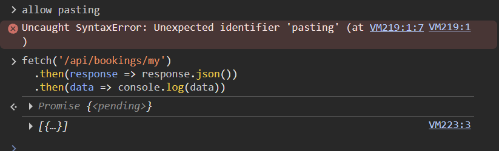 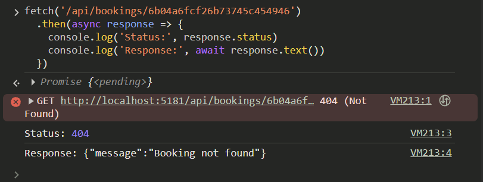 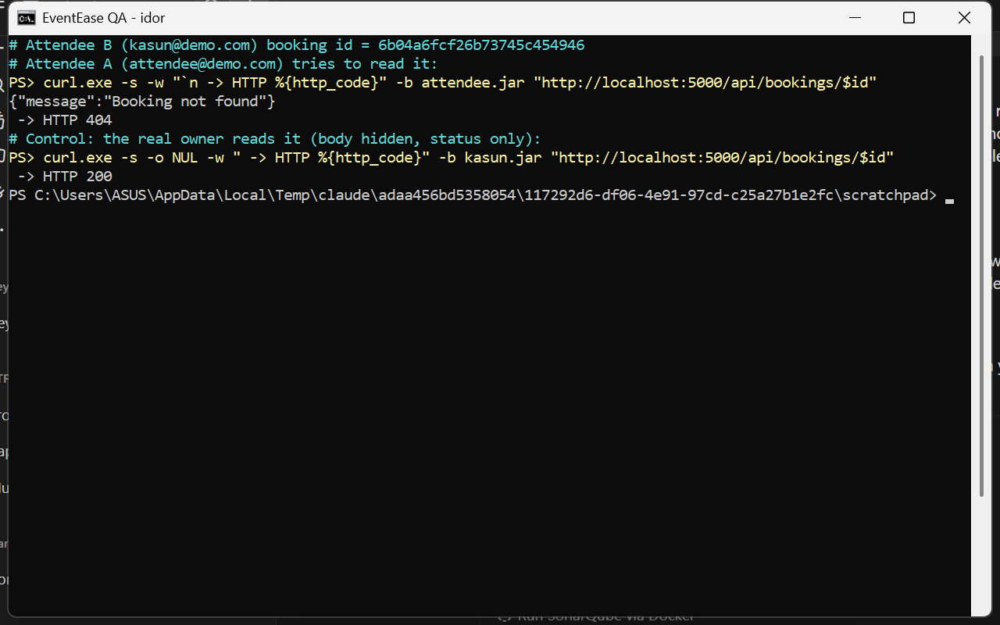

### A01-05 — Attendee cannot create events (role restriction)
- **OWASP:** A01  ·  **Status:** **PASS**
- **Steps:** POST /api/events as attendee with a valid event body
- **Expected:** HTTP 403
- **Actual:** HTTP 403 {"message":"You do not have permission to access this resource."}
- **Screenshot(s):** `owasp-13-role-restrictions-terminal.png`

### A01-06 — Attendee cannot call admin user-status endpoint
- **OWASP:** A01  ·  **Status:** **PASS**
- **Steps:** PATCH /api/admin/users/:id/status as attendee (own id, harmless value)
- **Expected:** HTTP 403
- **Actual:** HTTP 403 {"message":"You do not have permission to access this resource."}
- **Screenshot:** none (evidence in raw JSON log)

### A01-07 — Attendee cannot use ticket check-in (organizer/admin only)
- **OWASP:** A01  ·  **Status:** **PASS**
- **Steps:** POST /api/tickets/check-in as attendee
- **Expected:** HTTP 403
- **Actual:** HTTP 403 {"message":"You do not have permission to access this resource."}
- **Screenshot:** none (evidence in raw JSON log)

### A01-08 — Organizer cannot list all users (admin only)
- **OWASP:** A01  ·  **Status:** **PASS**
- **Steps:** GET /api/admin/users as organizer
- **Expected:** HTTP 403
- **Actual:** HTTP 403 {"message":"You do not have permission to access this resource."}
- **Screenshot(s):** `owasp-13-role-restrictions-terminal.png`

### A01-09 — Positive control: organizer CAN reach organizer dashboard (proves 403s above are real role checks)
- **OWASP:** A01  ·  **Status:** **PASS**
- **Steps:** GET /api/organizer/dashboard as organizer
- **Expected:** HTTP 200
- **Actual:** HTTP 200
- **Screenshot:** none (evidence in raw JSON log)

### A01-10 — Organizer 2 cannot edit Organizer 1's event
- **OWASP:** A01  ·  **Status:** **PASS**
- **Steps:** PATCH /api/events/:id as organizer2 (empty body so nothing changes even if allowed)
- **Expected:** HTTP 403
- **Actual:** HTTP 403 {"message":"You can only manage your own events"}
- **Notes / reason:** Throw-away event used. A 400 would mean the ownership check was skipped.
- **Screenshot(s):** `owasp-13-role-restrictions-terminal.png`

### A01-11 — Organizer 2 cannot read Organizer 1's attendee list
- **OWASP:** A01  ·  **Status:** **PASS**
- **Steps:** GET /api/organizer/events/:id/attendees as organizer2
- **Expected:** HTTP 403
- **Actual:** HTTP 403 {"message":"You can only view attendees for your own events"}
- **Screenshot(s):** `owasp-13-role-restrictions-terminal.png`

### A01-12 — Organizer 2 cannot publish Organizer 1's event
- **OWASP:** A01  ·  **Status:** **PASS**
- **Steps:** POST /api/events/:id/publish as organizer2
- **Expected:** HTTP 403
- **Actual:** HTTP 403 {"message":"You can only manage your own events"}
- **Screenshot:** none (evidence in raw JSON log)

### A01-13 — Organizer 2 cannot delete Organizer 1's event
- **OWASP:** A01  ·  **Status:** **PASS**
- **Steps:** DELETE /api/events/:id as organizer2 (throw-away event)
- **Expected:** HTTP 403
- **Actual:** HTTP 403 {"message":"You can only manage your own events"}
- **Screenshot(s):** `owasp-13-role-restrictions-terminal.png`

### A01-14 — Attendee cannot cancel another attendee's booking
- **OWASP:** A01  ·  **Status:** **NOT TESTED**
- **Steps:** Code review of cancelBooking (bookingController.js)
- **Expected:** Ownership check
- **Actual:** Code compares booking.attendeeId with req.user._id and returns 404 otherwise. NOT executed against live data because a vulnerability would cancel a real seeded booking.
- **Notes / reason:** Static review only; no dynamic evidence.
- **Screenshot:** none (evidence in raw JSON log)

### A01-15 — Mass assignment: role cannot be changed through PATCH /api/auth/me
- **OWASP:** A01  ·  **Status:** **PASS**
- **Steps:** PATCH /api/auth/me with role=admin; then GET /api/auth/me
- **Expected:** role remains attendee
- **Actual:** PATCH HTTP 200; role after = attendee
- **Screenshot(s):** `owasp-14-token-forgery-mass-assignment-terminal.png`

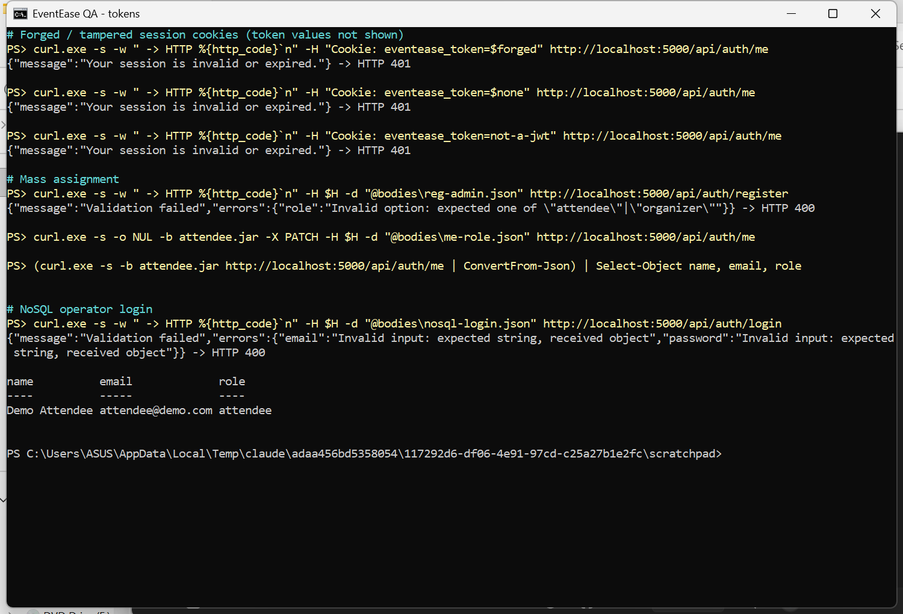

### A01-16 — Mass assignment: register cannot create an admin
- **OWASP:** A01  ·  **Status:** **PASS**
- **Steps:** POST /api/auth/register with role=admin
- **Expected:** HTTP 400 (role limited to attendee/organizer)
- **Actual:** HTTP 400 {"message":"Validation failed","errors":{"role":"Invalid option: expected one of \"attende…
- **Screenshot(s):** `owasp-14-token-forgery-mass-assignment-terminal.png`

### A01-17 — Self-registration with organizer role (design observation)
- **OWASP:** A01  ·  **Status:** **OBSERVATION**
- **Steps:** POST /api/auth/register with role=organizer
- **Expected:** Documented behaviour
- **Actual:** HTTP 201; new account role=organizer
- **Notes / reason:** Anyone can become an organizer without approval. Not admin escalation, but organizers can create events/QR check-in; consider an approval flow.
- **Screenshot:** none (evidence in raw JSON log)

### A01-18 — Forged / unsigned / malformed session tokens are rejected
- **OWASP:** A01  ·  **Status:** **PASS**
- **Steps:** GET /api/auth/me with (a) JWT signed with a wrong secret, (b) alg=none JWT, (c) garbage cookie
- **Expected:** HTTP 401 for all three
- **Actual:** wrong-secret=401, alg-none=401, garbage=401
- **Screenshot(s):** `owasp-14-token-forgery-mass-assignment-terminal.png`

### A01-19 — Suspended account cannot log in
- **OWASP:** A01  ·  **Status:** **PASS**
- **Steps:** POST /api/auth/login suspended@demo.com
- **Expected:** HTTP 403 (or 401)
- **Actual:** HTTP 403 {"message":"Your account is suspended. Contact support."}
- **Screenshot:** none (evidence in raw JSON log)

### A02-01 — Session cookie flags
- **OWASP:** A02  ·  **Status:** **PASS**
- **Steps:** Login; inspect Set-Cookie header (token value redacted)
- **Expected:** HttpOnly + SameSite set; Secure on HTTPS/production
- **Actual:** eventease_token=<redacted>; Max-Age=604800; Path=/; Expires=Tue, 01 Dec 2026 06:03:58 GMT; HttpOnly; SameSite=Lax  =>  HttpOnly=true, SameSite=Lax, Secure=false
- **Notes / reason:** Secure is false in this development run: authController sets secure only when NODE_ENV=production (code reviewed). Must be verified in production deployment.
- **Screenshot(s):** `owasp-25-session-cookie-flags-terminal.png`

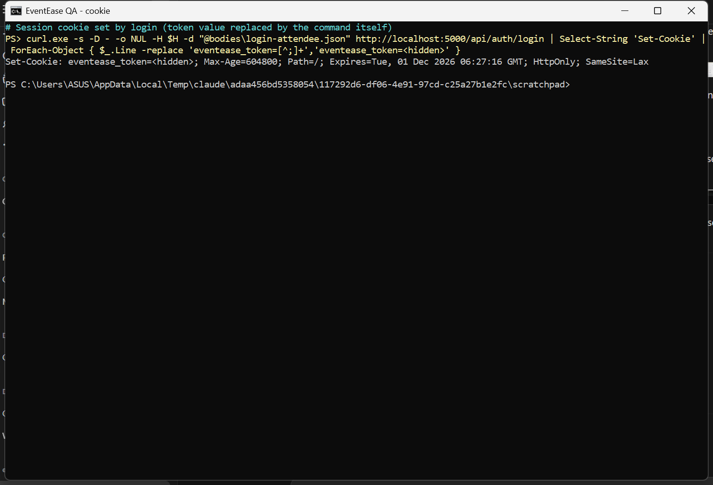

### A02-02 — API responses do not expose password hashes, reset tokens or secrets
- **OWASP:** A02  ·  **Status:** **PASS**
- **Steps:** Scan JSON of login, /auth/me, /bookings/my, /events, /notifications for sensitive key names
- **Expected:** No such keys
- **Actual:** No passwordHash / reset-token / secret keys in any scanned response
- **Notes / reason:** Key-name scan only; values not inspected.
- **Screenshot:** none (evidence in raw JSON log)

### A02-03 — JWT content and lifetime
- **OWASP:** A02  ·  **Status:** **PASS**
- **Steps:** Decode (not verify) the session JWT; list claim names only
- **Expected:** Minimal claims; reasonable expiry
- **Actual:** alg=HS256; claims=sub,iat,exp; lifetime=7 days
- **Notes / reason:** Only the user id is stored (no email/role/PII). 7-day lifetime with no revocation list is long (see A07-05).
- **Screenshot:** none (evidence in raw JSON log)

### A02-04 — Admin credentials must not be embedded in the browser bundle
- **OWASP:** A02  ·  **Status:** **PASS**
- **Steps:** Compare client/.env VITE_ADMIN_PASSWORD against the dev-served Login module and the production bundle in client/dist (values never printed)
- **Expected:** Secret absent from anything sent to the browser
- **Actual:** Admin password present in dev-server Login module: true. Fresh production build (vite build into a temp folder) contains the password: false; admin email: false. Existing client/dist: password false.
- **Notes / reason:** Corrected after fresh-build check: Login.jsx only renders the quick-login block when import.meta.env.DEV, so Vite removes it (and the VITE_ADMIN_* values) from production bundles. Residual risk: in development the admin password is delivered to any browser that opens the dev server, so never expose the dev server beyond localhost.
- **Screenshot:** none (evidence in raw JSON log)

### A02-05 — Session token not exposed to JavaScript or web storage
- **OWASP:** A02  ·  **Status:** **PASS**
- **Steps:** Login in Chrome; read localStorage, sessionStorage, document.cookie and context cookies
- **Expected:** Token only in an HttpOnly cookie
- **Actual:** localStorage keys=[]; sessionStorage keys=[]; document.cookie exposes token = false; cookie flags = [{"name":"eventease_token","httpOnly":true,"secure":false,"sameSite":"Lax","path":"/","expiresInDays":7}]; JWT found in web storage = false
- **Screenshot:** none (evidence in raw JSON log)

### A03-01 — NoSQL operator injection in login
- **OWASP:** A03  ·  **Status:** **PASS**
- **Steps:** POST /api/auth/login {"email":{"$ne":null},"password":{"$ne":null}}
- **Expected:** HTTP 400, no authentication
- **Actual:** HTTP 400 "Validation failed: expected string, received object" (first run by team member; re-run in this session, see screenshot).
- **Notes / reason:** zod schema validation rejects non-string values.
- **Screenshot(s):** `owasp-08-nosql-injection.png`, `owasp-14-token-forgery-mass-assignment-terminal.png`

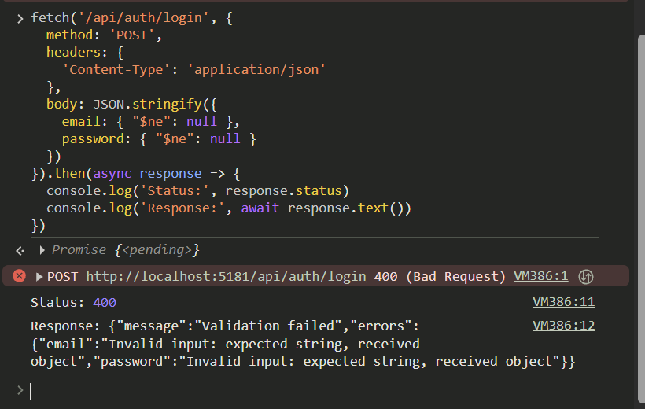 

### A03-02 — NoSQL operator object in forgot-password email
- **OWASP:** A03  ·  **Status:** **FAIL**
- **Steps:** POST /api/auth/forgot-password {"email":{"$ne":null}}
- **Expected:** Clean 400 or generic 200; no server error
- **Actual:** HTTP 500 {"message":"email.includes is not a function"}
- **Notes / reason:** Handler calls email.includes()/trim() on unvalidated input (no zod schema), producing an unhandled TypeError whose message is returned to the client.
- **Screenshot(s):** `owasp-15-error-handling-500-terminal.png`

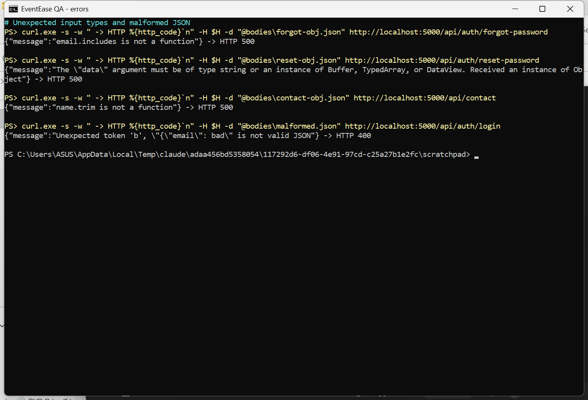

### A03-03 — NoSQL operator object in reset-password token
- **OWASP:** A03  ·  **Status:** **FAIL**
- **Steps:** POST /api/auth/reset-password {"token":{"$ne":null},"password":"Abcd1234"}
- **Expected:** Clean 400; no server error
- **Actual:** HTTP 500 {"message":"The \"data\" argument must be of type string or an instance of Buffer, TypedArray, or DataView. Received an instance of Object"}
- **Notes / reason:** Token is hashed with crypto before querying, so injection cannot match a user; failure mode is only an unhandled 500.
- **Screenshot(s):** `owasp-15-error-handling-500-terminal.png`

### A03-04 — Type confusion in contact form (object instead of string name)
- **OWASP:** A03  ·  **Status:** **FAIL**
- **Steps:** POST /api/contact {"name":{"$ne":1},...}
- **Expected:** Clean 400; no server error
- **Actual:** HTTP 500 {"message":"name.trim is not a function"}
- **Notes / reason:** contactController calls name.trim() without type checks.
- **Screenshot(s):** `owasp-15-error-handling-500-terminal.png`

### A03-05 — NoSQL operators in register are rejected (zod schema)
- **OWASP:** A03  ·  **Status:** **PASS**
- **Steps:** POST /api/auth/register with operator objects
- **Expected:** HTTP 400
- **Actual:** HTTP 400
- **Notes / reason:** zod type validation blocks it.
- **Screenshot:** none (evidence in raw JSON log)

### A03-06 — Query-string operator injection on event search
- **OWASP:** A03  ·  **Status:** **PASS**
- **Steps:** GET /api/events?category[$ne]=zzz&city[$regex]=.* vs plain GET /api/events
- **Expected:** Operators ignored / rejected; no error
- **Actual:** HTTP 200 (8 results) vs plain HTTP 200 (8 results)
- **Notes / reason:** Express 5 default "simple" query parser keeps keys flat, so operator syntax is not turned into objects.
- **Screenshot:** none (evidence in raw JSON log)

### A03-07 — javascript: URL in event banner is rejected
- **OWASP:** A03  ·  **Status:** **PASS**
- **Steps:** POST /api/events with bannerImage=javascript:alert(1)
- **Expected:** HTTP 400
- **Actual:** HTTP 400 {"message":"Validation failed","errors":{"bannerImage":"Enter a valid image URL"}}
- **Screenshot:** none (evidence in raw JSON log)

### A03-08 — Server-side validation of profileImage URL
- **OWASP:** A03  ·  **Status:** **FAIL**
- **Steps:** PATCH /api/auth/me {"profileImage":"javascript:alert(1)"} as QA user
- **Expected:** HTTP 400 (only http/https allowed)
- **Actual:** HTTP 200; stored value = javascript:alert(1)
- **Notes / reason:** Only the React form validates (Profile.jsx isHttpUrl); the API accepts any string. Currently rendered only after an isHttpUrl check, so no exploit today, but any new consumer would be exposed.
- **Screenshot(s):** `owasp-23-profileimage-no-server-validation-terminal.png`

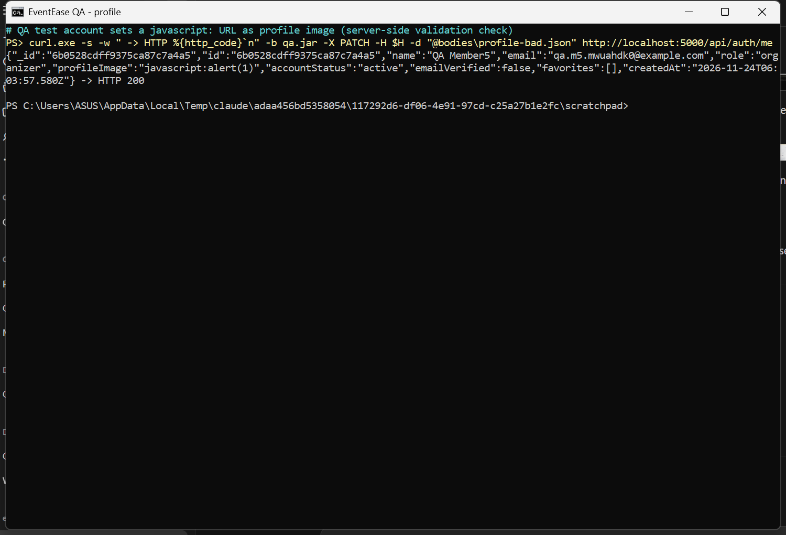

### A03-09 — Review comments (stored XSS surface) reachable for testing
- **OWASP:** A03  ·  **Status:** **FAIL**
- **Steps:** Try GET /api/events/:id/reviews, GET /api/reviews, POST /api/reviews
- **Expected:** A working review endpoint to test
- **Actual:** GET /api/events/:id/reviews = 404; GET /api/reviews = 404 {"message":"Event not found"}; POST /api/reviews (no auth) = 401
- **Notes / reason:** Defect: reviewRoutes is mounted at /api/reviews but its handlers read req.params.id (an event id) that the mount path never provides, and the React app never calls reviews. Review XSS therefore could not be tested; the feature is unreachable.
- **Screenshot(s):** `owasp-22-review-endpoints-unreachable-terminal.png`

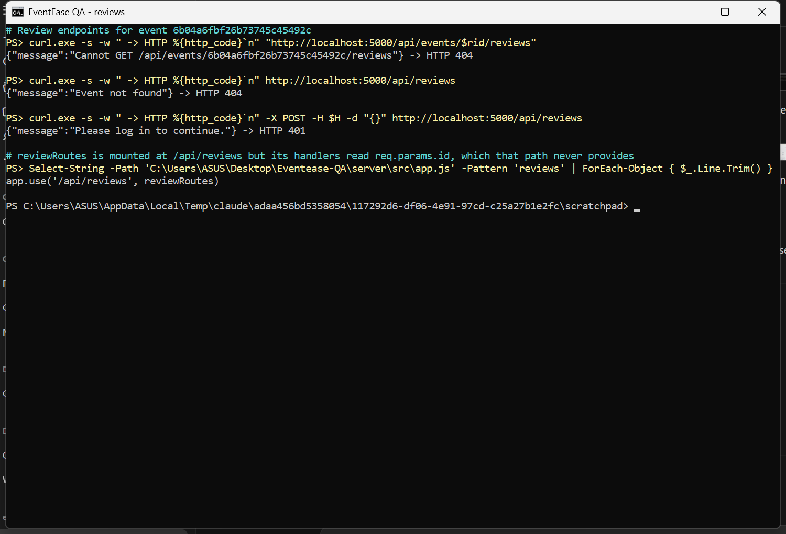

### A03-10 — Stored XSS in event title (event details page)
- **OWASP:** A03  ·  **Status:** **PASS**
- **Steps:** Organizer opens the event titled  in Chrome; automation watches for dialogs and injected nodes
- **Expected:** Title rendered as inert text, no script executed
- **Actual:** Event details h1 text = ""; <script> elements injected into DOM = 0; alert dialogs fired = 0; document.title = "EventEase – Discover Events. Create Memories."
- **Screenshot(s):** `owasp-09-xss-event-title.png`, `owasp-09a-xss-event-title-manage-events.png`

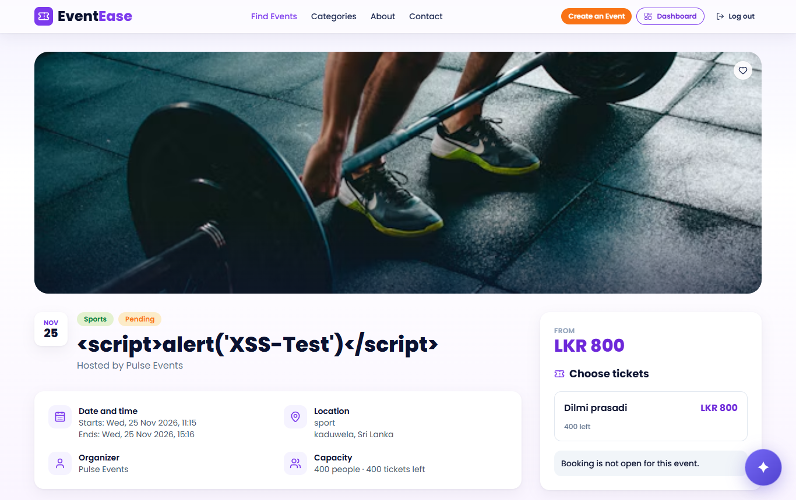 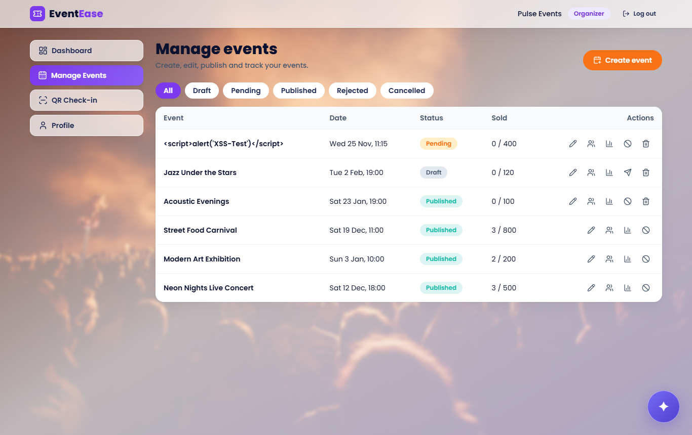

### A03-11 — XSS payload through the contact form
- **OWASP:** A03  ·  **Status:** **PASS**
- **Steps:** Enter <script>/ payloads in the contact form and submit in Chrome
- **Expected:** No script execution
- **Actual:** Server accepted the payload (success message shown = true); alert dialogs fired = 0; injected  elements = 0. The form re-renders values via React text bindings, so the payload stays inert.
- **Notes / reason:** The raw payload is stored unmodified in the database (no output encoding needed server-side for JSON APIs, but any future admin view must also escape it). No admin screen displays contact messages today, so stored rendering could not be checked.
- **Screenshot(s):** `owasp-10a-xss-contact-form-payload-entered.png`, `owasp-10-xss-contact-form.png`

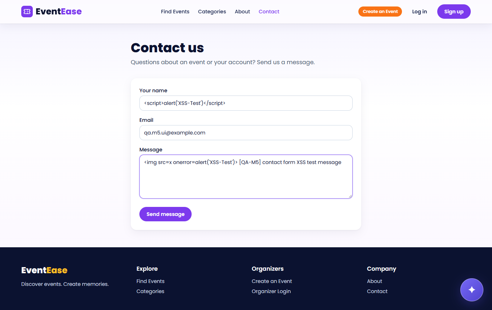 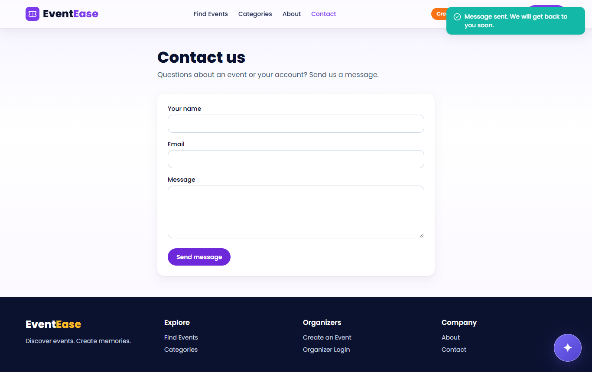

### A03-12 — XSS payload in profile name (QA account)
- **OWASP:** A03  ·  **Status:** **PASS**
- **Steps:** Save the name  in Profile, reload page
- **Expected:** Name displayed as text only
- **Actual:** Profile name saved as "" and re-loaded; injected  elements = 0; alert dialogs fired = 0
- **Screenshot(s):** `owasp-11-xss-profile-name.png`

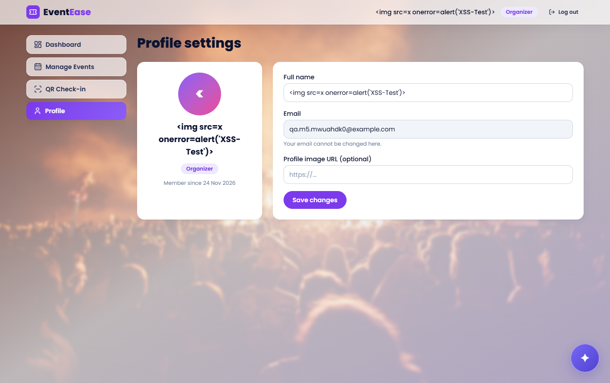

### A05-01 — Security headers on the API (Helmet)
- **OWASP:** A05  ·  **Status:** **PASS**
- **Steps:** GET /api/health; inspect response headers
- **Expected:** Helmet headers present; X-Powered-By absent
- **Actual:** present=content-security-policy, x-content-type-options, x-frame-options, strict-transport-security, referrer-policy, cross-origin-opener-policy, cross-origin-resource-policy, x-dns-prefetch-control; missing=none; x-powered-by=absent; CORP=cross-origin
- **Notes / reason:** Cross-Origin-Resource-Policy is deliberately relaxed to cross-origin in app.js.
- **Screenshot(s):** `owasp-16-security-headers-api-terminal.png`

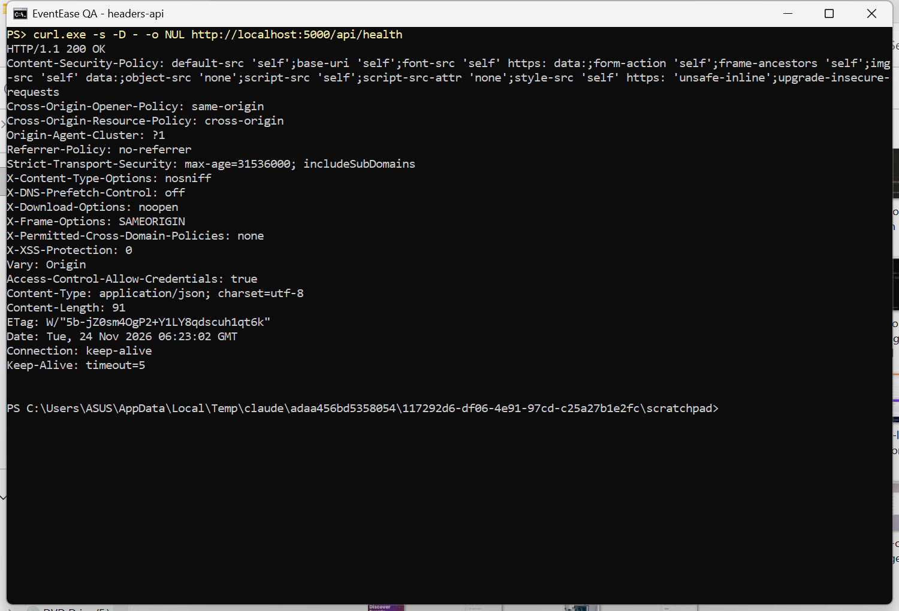

### A05-02 — Security headers on the frontend web server
- **OWASP:** A05  ·  **Status:** **FAIL**
- **Steps:** GET http://localhost:5180/ (Vite dev server); inspect response headers
- **Expected:** CSP, X-Frame-Options, X-Content-Type-Options, Referrer-Policy
- **Actual:** missing=content-security-policy, x-frame-options, x-content-type-options, referrer-policy
- **Notes / reason:** Measured against the Vite dev server only. The production host that serves client/dist must add these (clickjacking / CSP protection) - Helmet only protects the API. Confirmed by config: client/vercel.json (the documented production host) defines rewrites only and no headers block, so production will also lack CSP / X-Frame-Options.
- **Screenshot(s):** `owasp-16b-security-headers-frontend-terminal.png`

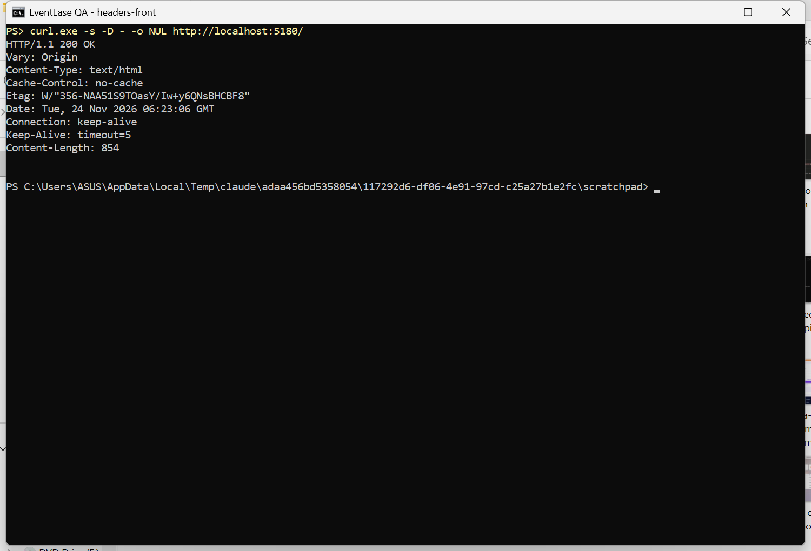

### A05-03 — CORS must not trust arbitrary origins when credentials are enabled
- **OWASP:** A05  ·  **Status:** **FAIL**
- **Steps:** Request with Origin: https://evil.example; check Access-Control-Allow-Origin / -Credentials (server NODE_ENV=development)
- **Expected:** Untrusted origin NOT echoed
- **Actual:** ACAO=https://evil.example; ACAC=true; preflight=204
- **Notes / reason:** app.js allows every origin whenever NODE_ENV !== "production". With credentials:true this means any website could make authenticated calls if the server is ever run without NODE_ENV=production. SameSite=Lax limits cross-site cookie sending, which reduces but does not remove the risk.
- **Screenshot(s):** `owasp-17-cors-untrusted-origin-terminal.png`

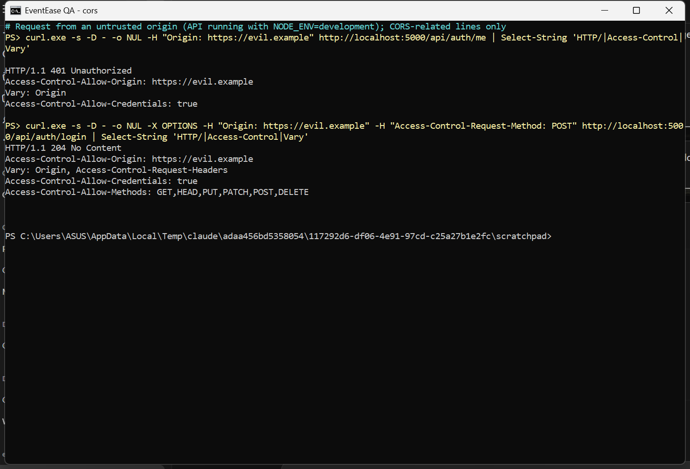

### A05-04 — Malformed JSON does not leak stack traces
- **OWASP:** A05  ·  **Status:** **PASS**
- **Steps:** POST /api/auth/login with body {"email": bad
- **Expected:** HTTP 400, generic message, no stack
- **Actual:** HTTP 400 {"message":"Unexpected token 'b', \"{\"email\": bad\" is not valid JSON"}
- **Notes / reason:** No stack trace, but parser message is echoed (minor information disclosure).
- **Screenshot(s):** `owasp-15-error-handling-500-terminal.png`

### A05-05 — Unhandled 500 errors do not reveal internals
- **OWASP:** A05  ·  **Status:** **FAIL**
- **Steps:** Re-use response of A03-02 (forgot-password with object email)
- **Expected:** Generic message, no stack/internal names
- **Actual:** HTTP 500 body={"message":"email.includes is not a function"}; stack trace present=false
- **Notes / reason:** errorHandler returns err.message for every 500, including internal JavaScript messages. Production should return a generic text for status>=500.
- **Screenshot(s):** `owasp-15-error-handling-500-terminal.png`

### A05-06 — Request body size limit enforced
- **OWASP:** A05  ·  **Status:** **PASS**
- **Steps:** POST 3 MB JSON to /api/chat (limit configured 2 MB)
- **Expected:** HTTP 413
- **Actual:** HTTP 413 {"message":"request entity too large"}
- **Screenshot:** none (evidence in raw JSON log)

### A05-07 — Sensitive files not served by the API
- **OWASP:** A05  ·  **Status:** **PASS**
- **Steps:** GET /.env, /server/.env, /package.json, /.git/config on port 5000
- **Expected:** HTTP 404 for all
- **Actual:** /.env=404, /server/.env=404, /package.json=404, /.git/config=404
- **Screenshot:** none (evidence in raw JSON log)

### A05-08 — .env files are excluded from Git
- **OWASP:** A05  ·  **Status:** **PASS**
- **Steps:** git check-ignore on server/.env and client/.env; git ls-files; git log history for those paths
- **Expected:** Ignored, untracked, never committed
- **Actual:** check-ignore: .gitignore:3:.env	server/.env | .gitignore:3:.env	client/.env; tracked env files: client/.env.example, server/.env.example; history commits touching them: none
- **Notes / reason:** Only .env.example is tracked.
- **Screenshot(s):** `owasp-21-env-gitignore-terminal.png`

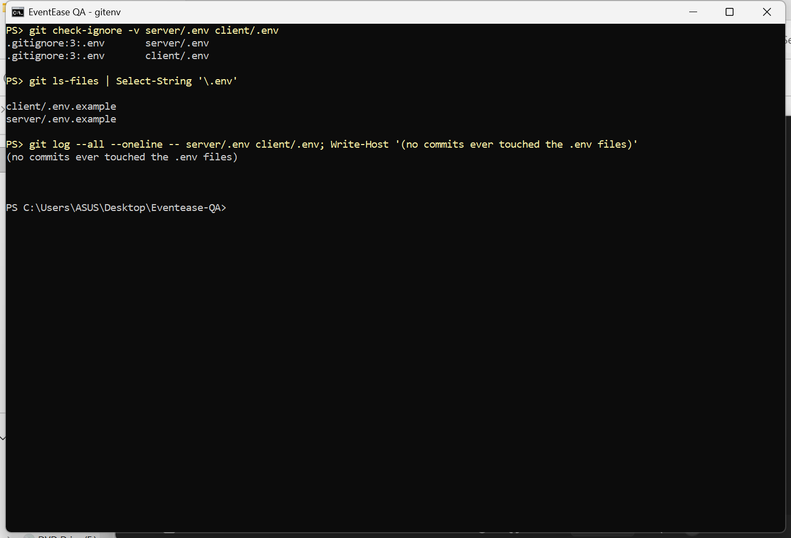

### A06-01 — Backend dependencies free of known vulnerabilities
- **OWASP:** A06  ·  **Status:** **FAIL**
- **Steps:** cd server; npm audit (run by team member; re-run read-only on 2026-11-24 to confirm)
- **Expected:** 0 high/critical vulnerabilities
- **Actual:** 4 vulnerabilities: 2 high (body-parser, mongoose), 2 moderate (minimatch, nodemon). 0 critical.
- **Notes / reason:** body-parser and mongoose have a non-breaking fix available; nodemon/minimatch (dev tool) needs a semver-major nodemon bump. Nothing was upgraded (baseline preserved). Raw: raw/npm-audit-server.txt
- **Screenshot(s):** `owasp-01-backend-npm-audit.png`

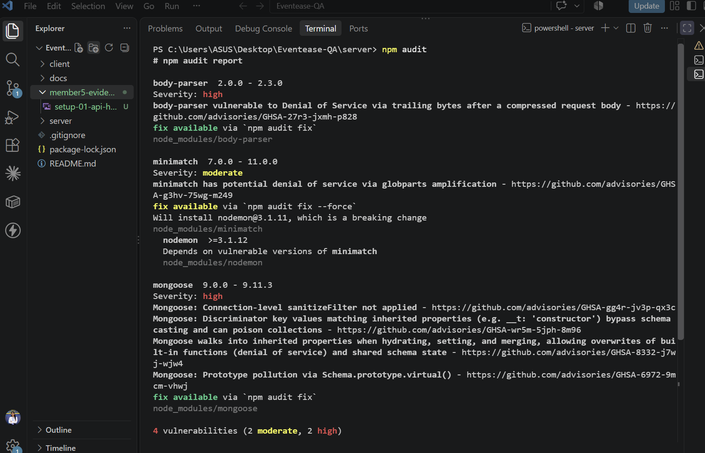

### A06-02 — Frontend dependencies free of known vulnerabilities
- **OWASP:** A06  ·  **Status:** **FAIL**
- **Steps:** cd client; npm audit
- **Expected:** 0 high/critical vulnerabilities
- **Actual:** 1 high vulnerability: follow-redirects (transitive, fix available).
- **Notes / reason:** Raw: raw/npm-audit-client.txt
- **Screenshot(s):** `owasp-02-frontend-npm-audit.png`

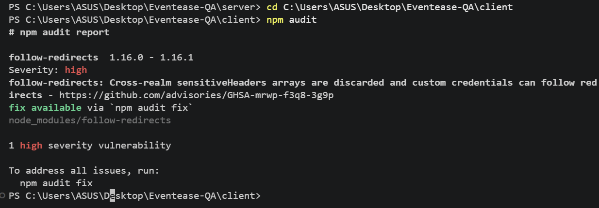

### A07-01 — Brute-force protection / rate limiting on login
- **OWASP:** A07  ·  **Status:** **FAIL**
- **Steps:** 20 consecutive wrong-password logins against the QA test account only (never a real/demo user), then one correct login
- **Expected:** Throttling (HTTP 429) or lockout before 20 attempts
- **Actual:** statuses: 401×20; correct login after the burst = HTTP 200
- **Notes / reason:** express-rate-limit is listed in server/package.json but never imported (grep over server/src returns no usage). No lockout either: the correct password still works after the burst.
- **Screenshot(s):** `owasp-18-login-rate-limit-terminal.png`

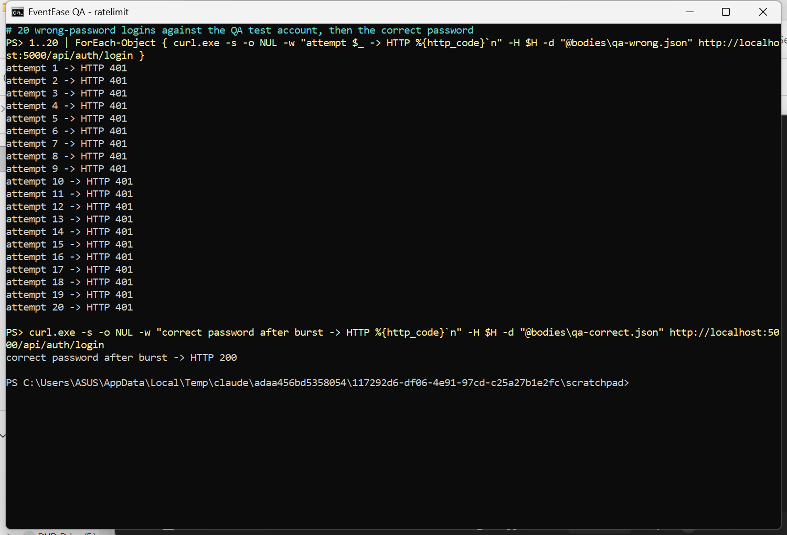

### A07-02 — Weak password rules on registration
- **OWASP:** A07  ·  **Status:** **PASS**
- **Steps:** Register with: "123", "12345678", "abcdefgh", 74-char password
- **Expected:** All rejected with HTTP 400
- **Actual:** too short→400; digits only→400; letters only→400; >72 chars→400
- **Notes / reason:** Rules: 8–72 chars, at least one letter and one number.
- **Screenshot(s):** `owasp-19-password-policy-enumeration-terminal.png`

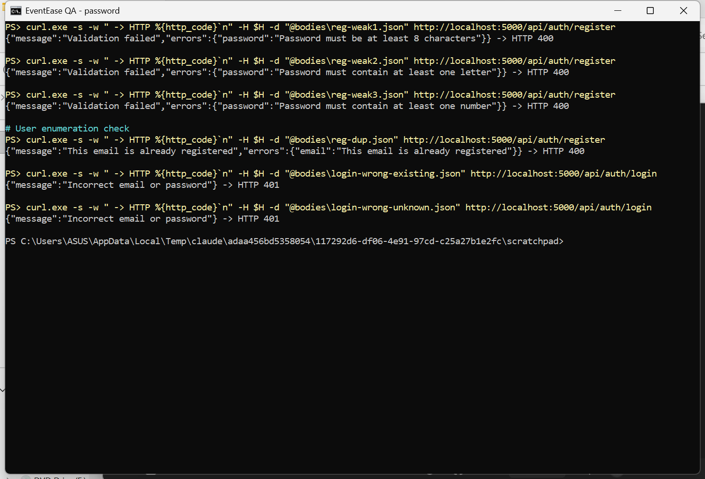

### A07-03 — Common/breached passwords are rejected
- **OWASP:** A07  ·  **Status:** **FAIL**
- **Steps:** Register with the very common password "password1" (QA account)
- **Expected:** HTTP 400 (blocklist) 
- **Actual:** HTTP 201
- **Notes / reason:** Only composition rules exist; no common-password blocklist, no special-character or breach check (NIST SP 800-63B recommends a blocklist).
- **Screenshot:** none (evidence in raw JSON log)

### A07-04 — User enumeration
- **OWASP:** A07  ·  **Status:** **FAIL**
- **Steps:** Compare responses: register existing email; login wrong password vs unknown email
- **Expected:** Identical, non-revealing responses
- **Actual:** register existing → HTTP 400 "This email is already registered"; login wrong pw → "Incorrect email or password"; login unknown email → "Incorrect email or password"
- **Notes / reason:** Login is generic (good) but registration confirms which emails exist (low severity, common trade-off).
- **Screenshot(s):** `owasp-19-password-policy-enumeration-terminal.png`

### A07-05 — Session token is invalidated by logout
- **OWASP:** A07  ·  **Status:** **FAIL**
- **Steps:** Login, copy cookie, POST /api/auth/logout, replay the old cookie on GET /api/auth/me
- **Expected:** HTTP 401 after logout
- **Actual:** HTTP 200 after replaying the pre-logout cookie
- **Notes / reason:** Logout only clears the browser cookie; the JWT stays valid for its full 7 days (stateless, no server-side revocation or token version).
- **Screenshot(s):** `owasp-20-session-after-logout-terminal.png`

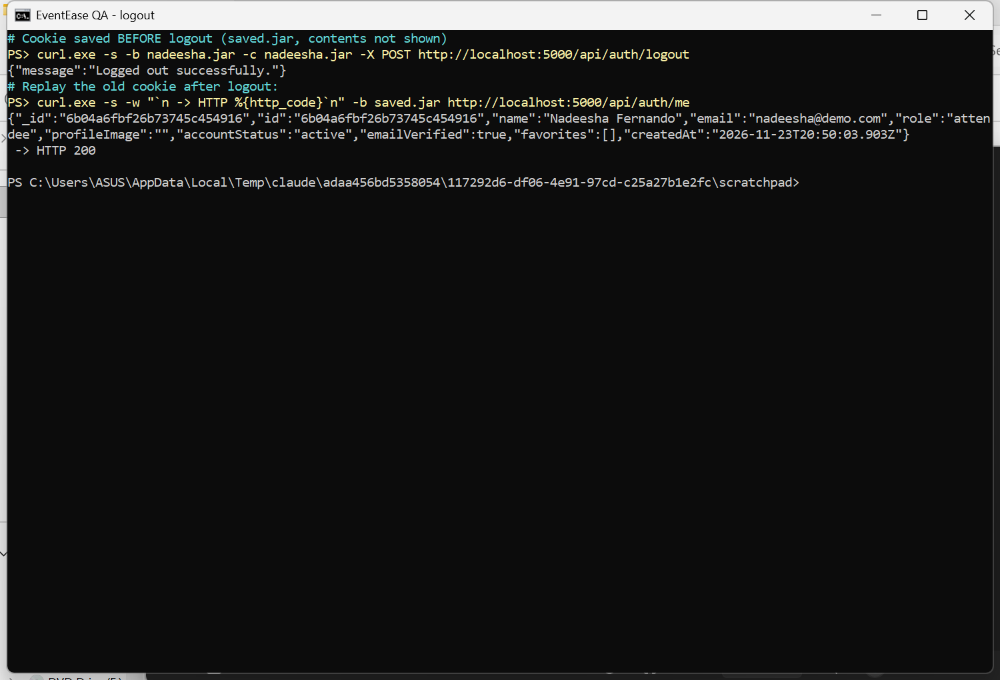

### A07-06 — Forgot-password does not reveal whether the email exists
- **OWASP:** A07  ·  **Status:** **PASS**
- **Steps:** POST forgot-password for QA account vs non-existent email
- **Expected:** Identical response
- **Actual:** existing: HTTP 200 "If that email exists, a reset link has been sent."; unknown: HTTP 200 "If that email exists, a reset link has been sent."
- **Notes / reason:** Run against a private second API instance on port 5099 (same code and DB) so the reset link logged to its console could be read.
- **Screenshot:** none (evidence in raw JSON log)

### A07-07 — Reset-token lifecycle: weak password rejected, invalid token rejected, one-time use, old password revoked
- **OWASP:** A07  ·  **Status:** **PASS**
- **Steps:** Request reset for QA account; read token from private instance console; test weak pw, bogus token, valid reset, token re-use, old/new password login
- **Expected:** weak=400, bogus=400, valid=200, reuse=400, old pw=401, new pw=200
- **Actual:** weak=400, bogus=400, valid=200, reuse=400, oldPw=401, newPw=200
- **Notes / reason:** Token is 32 random bytes, only its SHA-256 is stored, 1-hour expiry (code reviewed). Side note: the full reset URL is written to the server console (acceptable for dev, must be replaced by e-mail in production).
- **Screenshot:** none (evidence in raw JSON log)

## 5. Tests not performed and why

| Item | Reason |
|---|---|
| A01-14 cancel another user's booking | A failing check would have cancelled a real seeded booking; code review only (cancelBooking compares attendeeId to the caller and returns 404). |
| Stored-XSS through reviews | Review endpoints are unreachable (A03-09), so there was nothing to test. |
| Stored-XSS rendering of contact messages | No screen in the app lists contact messages. |
| Live ReDoS against the running API | Would freeze the shared dev server; the regex was timed in isolation instead (BUG-014). |
| OWASP ZAP | Optional; image not installed. |
| Production-only behaviour (Secure cookie, restricted CORS, HTTPS) | Tests ran against a development configuration (`NODE_ENV=development`). |
