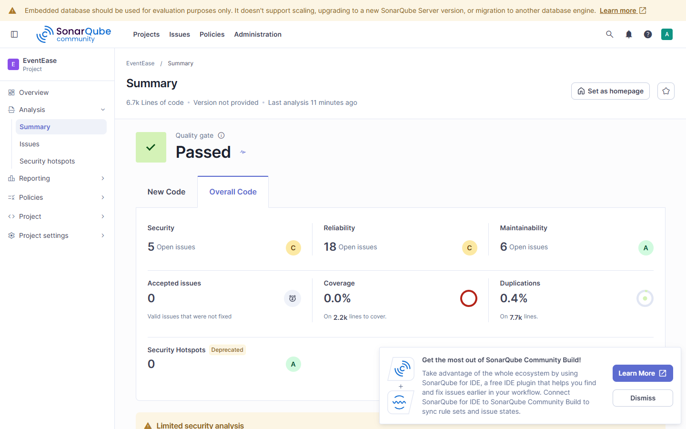

# SonarQube Code Quality Analysis — EventEase

**Member 5 – Security & Quality Assurance (EC4206 Section 3.9)** · Analysis date: 2026-11-24 · Commit analysed: `8030765` (branch `member5-security-qa`)

## 1. Setup (what was actually run)

| Item | Value |
|---|---|
| Server | SonarQube **Community Build 26.11.0** (`sonarqube:community`, 2.5 GB image) in Docker container `eventease-sonarqube`, port 9000 |
| Isolation | Own container and own volumes (`eventease_sonar_data`, `eventease_sonar_logs`, `eventease_sonar_ext`); no other container, volume or compose file was touched |
| Settings | `SONAR_ES_BOOTSTRAP_CHECKS_DISABLE=true` (Docker Desktop); embedded H2 database (SonarQube shows an "evaluation use only" banner) |
| Scanner | `sonarsource/sonar-scanner-cli` (**SonarScanner CLI 8.5.0.16571**), run as a one-off container |
| Project key | `eventease` |
| Scope | `client/src` and `server/src` (101 source files, **6,697 lines of code**, JavaScript/JSX); `node_modules` and `dist` excluded; scanner working directory kept in `/tmp` so nothing was written into the repository |
| Credentials | Default admin password changed immediately; a user token was generated. Neither is recorded in this report or in any screenshot. |
| Result of run | `ANALYSIS SUCCESSFUL`, total time 4 min 38 s |

Command used (token value omitted):
```powershell
docker run --rm -e SONAR_HOST_URL=http://host.docker.internal:9000 -e SONAR_TOKEN=<token> `
  -v "C:\Users\ASUS\Desktop\Eventease-QA:/usr/src" sonarsource/sonar-scanner-cli:latest `
  -Dsonar.projectKey=eventease -Dsonar.sources=client/src,server/src `
  -Dsonar.exclusions="**/node_modules/**,**/dist/**" -Dsonar.working.directory=/tmp/scannerwork
```

## 2. Results (read from the SonarQube API; raw files `raw/sonar-measures.json`, `raw/sonar-quality-gate.json`, `raw/sonar-issues.json`)

| Metric | Value |
|---|---|
| **Quality Gate** | **Passed** (Sonar way; the gate judges *new* code, and this was the first analysis) |
| Security | **5 open issues, rating C** |
| Reliability | **18 open issues, rating C** |
| Maintainability | **6 open issues, rating A** |
| Legacy issue types | 9 bugs · 5 vulnerabilities · 9 code smells · **23 issues in total** |
| Security hotspots | 0 |
| Coverage | **0.0 %** (on 2.2 k coverable lines; no coverage report was supplied) |
| Duplications | **0.4 %** (2 duplicated blocks) |
| Technical debt (SQALE index) | 78 minutes |
| Cyclomatic complexity | 1,497 |
| Cognitive complexity | 725 |
| Lines of code | 6,697 in 101 files (client 3,624 · server 3,073) |

*Note on counts:* SonarQube's current dashboard groups issues by software quality (Security / Reliability / Maintainability, an issue may count in more than one) while the API still reports the classic types (bug / vulnerability / code smell). Both views describe the same 23 issues.

**Limitations shown by SonarQube itself:** the dashboard displays "Limited security analysis" (the Community Build does not perform the deeper taint analysis); coverage is 0 % because the project's `npm test` runs a custom script (`testSuite.js`) that is not instrumented for coverage.

## 3. Screenshots (real SonarQube UI in Chrome)

| File | Shows |
|---|---|
| `screenshots/sonarqube-01-dashboard.png` | Summary: Quality Gate Passed, issue counts and ratings, coverage, duplications |
| `screenshots/sonarqube-02-issues-bugs.png` | The 9 bug-type issues |
| `screenshots/sonarqube-03-issues-vulnerabilities.png` | The 5 vulnerability-type issues |
| `screenshots/sonarqube-04-issues-code-smells.png` | The 9 code smells |
| `screenshots/sonarqube-05-measures-overview.png` | Measures overview |
| `screenshots/sonarqube-06-code-structure.png` | Per-folder/file breakdown |



## 4. Triage of all 23 issues (each flagged line was opened in the source)

### 4.1 "Bugs" (9)
| Rule | Location | Assessment |
|---|---|---|
| S9383 "Promises must be awaited" | `SearchBar.jsx:19`, `DashboardLayout.jsx:45`, `Navbar.jsx:23`, `EventDetails.jsx:59`, `EventForm.jsx:63,81` | These are `navigate(...)` calls from React Router v7, which may return a Promise. Ignoring the result does not cause a failure here → **low impact / probable false positive**. |
| S9383 | `server/src/server.js:15` (`startServer()`) | **Genuine, low severity**: add `.catch(...)` so a rejected start is logged; `connectDB` already exits the process on DB failure. |
| S9383 | `server/src/utils/testSuite.js:320` | Genuine but test-only; add `.catch`. |
| S6544 "non-Promise in boolean conditional" | `authController.js:131` (`if (!passwordMatches)`) | **False positive**: the value is the awaited boolean from `bcrypt.compare`. |

Conclusion: none of the 9 "bugs" reproduced as a runtime defect; they are *not* in the bug register except where they overlap a real finding.

### 4.2 Vulnerabilities (5)
| Rule | Location | Assessment |
|---|---|---|
| S2245 weak PRNG | `client/src/mock/db.js:78,100` | `Math.random` used for mock-data IDs in the in-browser mock adapter; not security-relevant (mock only). Accepted. |
| S2068 hard-coded password | `client/src/mock/db.js:127`, `server/src/utils/testSuite.js:87,143` | shared demo password (documented in the README). The same password seeds the demo accounts, so it must never be seeded in production → **BUG-015 (Low)**. |

### 4.3 Code smells (9)
| Rule | Location | Assessment |
|---|---|---|
| S8786 regex with super-linear runtime | `contactController.js:9`, `models/User.js:21`, `client/utils/validate.js:5` | **Genuine, confirmed by timing** (4.7 s for 80 k characters) → **BUG-014 (Medium)**. |
| S7773 prefer `Number.isNaN` | `eventController.js:26,27,52`, `validate.js:14` | Genuine but trivial style/robustness. Fix is a one-word change. |
| S6848 non-native interactive element | `ConfirmDialog.jsx:15` | Accessibility smell; worth fixing together with BUG-012/013. |
| S9379 `autoFocus` attribute | `organizer/CheckIn.jsx:57` | Deliberate (scanner input should be focused); accessibility trade-off, acceptable with justification. |

## 5. Interpretation
- **Code structure is healthy**: duplication 0.4 %, maintainability A, only 78 min of technical debt for ~6.7 k lines.
- **Quality Gate "Passed" does not mean "no problems"**: the gate only looks at new code on this first scan, and coverage is 0 %.
- **The valuable SonarQube findings** are the ReDoS-prone regex (S8786) and the hard-coded credentials; the "bugs" are mostly noise from a very new rule (S9383).
- SonarQube found **none** of the real security weaknesses discovered by testing (no rate limiting, CORS, logout, unhandled 500s, unreachable reviews). Static analysis and dynamic testing are complementary.

## 6. Proposed improvements (from the SonarQube findings)

1. **Replace the three email regular expressions (rule S8786, `contactController.js:9`, `models/User.js:21`, `client/utils/validate.js:5`).** They backtrack quadratically (4.7 s for 80,000 characters). Validate with a bounded check instead, for example zod `z.string().trim().max(254).email()`. Expected result: three code smells and BUG-014 removed.
2. **Add automated tests with coverage reporting.** Coverage is 0.0 % on 2.2 k coverable lines because `npm test` is an uninstrumented script. Switch to Jest or Vitest with coverage output (lcov) and feed it to SonarQube; target at least 60 % for the controllers first.
3. **Remove hard-coded credentials and handle promises.** Move the shared demo password out of `testSuite.js` and `mock/db.js` into environment or seed configuration (S2068 ×3, BUG-015), use a cryptographic ID source or mark mock IDs as non-secret (S2245 ×2), and add `.catch(...)` to `startServer()` and the test runner (S9383). Expected result: the 5 vulnerabilities and the genuine "bugs" cleared.

## 7. Housekeeping
- The container `eventease-sonarqube` is **still running** (uses about 2.4 GB RAM) so the dashboard can be shown. Stop it with `docker stop eventease-sonarqube`; start again with `docker start eventease-sonarqube`. Remove everything (only after the report is submitted): `docker rm -f eventease-sonarqube` and `docker volume rm eventease_sonar_data eventease_sonar_logs eventease_sonar_ext`.
- The images take about 4 GB of disk. The C: drive was ~98 % full before the pull, so free space is limited.
